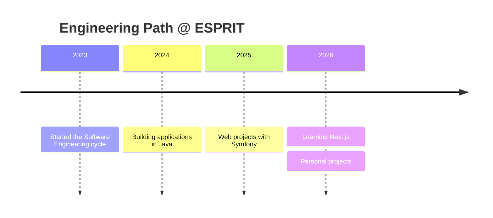

<!-- ═══════════════════════ HEADER ═══════════════════════ -->
<div align="center">


<a href="https://git.io/typing-svg">
  
</a>

<br/>


<br/><br/>

[](https://linkedin.com/in/aziz-nasri-0a279a271)
[](mailto:aziz228asri@gmail.com)
[](https://github.com/3abch9leu)

</div>

---

## 👨‍💻 About Me

```yaml
name:      Mohamed Aziz Nasri
location:  Tunisia 🇹🇳
studying:  Software Engineering (Cycle Ingénieur) @ ESPRIT, since 2023
focus:     Web development · UI/UX · Graphic design
exploring: Artificial Intelligence · Cybersecurity · Networks
languages: Arabic (native) · English (fluent) · French (intermediate)
looking_for: Internship / first professional experience 🚀
```

I'm a rigorous and curious engineering student who enjoys turning ideas into polished products: from a clean database schema to a pixel-perfect interface. I'm currently looking for an **internship or first professional opportunity** where I can apply my technical and creative skills.

---

## 🛠️ Tech Stack

### Languages
<p>
  
</p>

### Frameworks & Libraries
<p>
  
</p>

### Databases
<p>
  
</p>

### Design & Tools
<p>
  
  
</p>

### Networking


---

## 🚀 Featured Projects

<table>
  <tr>
    <td width="50%" valign="top">

### 🎓 EduTech
**Desktop educational platform**

Multi-screen app (login, dashboard, admin back-office) with:
- 🧠 Adaptive quizzes with analytics tracking
- 🗓️ Room booking & scheduling system
- 🎙️ AI voice assistant (speech recognition & synthesis, natural-language commands)
- 📹 Real-time video chat (webcam, UDP audio/video streaming, peer-to-peer rooms)
- 🛠️ Full back-office: courses, quizzes, users, bookings, rooms & equipment


    </td>
    <td width="50%" valign="top">

### 💊 Smart Pharmacy
**Pharmacy management web app**

Complete solution to manage:
- 📦 Stock & inventory
- 💰 Sales
- 📄 Prescriptions

Built as part of my engineering curriculum with a clean MVC architecture.


    </td>
  </tr>
  <tr>
    <td colspan="2" valign="top">

### 🌐 Enterprise Network
**Network design & simulation**

Design and simulation of a company network topology in Cisco Packet Tracer: **OSPF routing, VPN, DHCP and NAT addressing**.


    </td>
  </tr>
</table>

> 📌 *Pin your best repositories on your profile to showcase them here!*

---

## 🗺️ My Journey



---

## 📊 GitHub Stats

<div align="center">


<br/>


<br/>


</div>

---

## 🎯 Currently

- 🔭 Deepening my skills in **Next.js** and building personal projects
- 🌱 Exploring **AI**, **cybersecurity** and **networks**
- 🎨 Creating designs with **Figma**, **Photoshop** and **Illustrator**
- 💼 Open to **internships** and first professional experiences

## 🎮 Beyond the Code

`UI/UX Design` · `Graphic Design` · `Cybersecurity` · `Sport` · `Video Games`

---

<div align="center">

### 🤝 Let's connect!

*Got an opportunity, an idea or just want to say hi? My inbox is open.*

[](https://linkedin.com/in/aziz-nasri-0a279a271)
[](mailto:aziz228asri@gmail.com)


</div>
